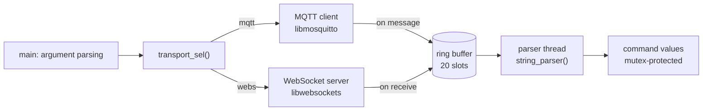

# IoT Device Simulator: Modular Transport and Command Framework in C

[](https://github.com/CyrusRaza/iot_device_sim/actions/workflows/ci.yaml)


A simulated IoT edge device written in C11. It receives configuration commands over a runtime-selectable transport (MQTT or WebSocket), hands them to a separate parser thread through a bounded queue, and applies them to the device state.

The goal is to practise the patterns used in embedded firmware on a desktop target first: an interface in plain C (function-pointer table and opaque objects), a producer/consumer split between I/O and processing, and unit-tested core logic. It runs on Linux; it has not been ported to a microcontroller yet.

## What it does

1. The device starts with a device ID, a transport (`mqtt` or `webs`) and a port.
2. The selected transport is created behind a common interface and connects:
   - **MQTT:** a libmosquitto client connects to a local broker, subscribes to `test/sub` and publishes a status message on `test/pub` once per second.
   - **WebSocket:** a libwebsockets server accepts a client on the given port.
3. Every incoming message is pushed into a bounded ring buffer.
4. A parser thread pops messages, parses `key: value` pairs and updates the matching command value (for example `temp_set` or `pub_rate`). Unknown keys and non-integer values are ignored.

Example message:

```
{temp_set: 25, pub_rate: 20}
```

## Architecture



### Transport interface (strategy pattern in C)

Every transport embeds a `transport_type` whose first member is a pointer to a function table:

```c
typedef struct transport_vtable {
    int (*init)(transport_type *self);
    int (*connect)(transport_type *self);
    int (*poll)(transport_type *self);
    int (*publish)(transport_type *self);
    int (*destroy)(transport_type *self);
} transport_vtable;
```

`main` only calls `tra->vt->init(tra)`, `connect`, `publish` and `destroy`. Adding a transport means writing one new source file with a constructor and its function table; `main` and the parser do not change.

### Concurrency

| Part | Mechanism |
|---|---|
| Parser thread | C11 `threads.h` (`thrd_create`, `thrd_join`) |
| Message queue | Single-producer, single-consumer ring buffer with C11 atomic read/write indices |
| Producer back-pressure | POSIX named semaphores (`sem_open`) around `queue_push` in the transport callbacks |
| Shared command values | C11 mutex (`mtx_t`) |

## Repository layout

```
.
├── device/
│   ├── CMakeLists.txt
│   ├── include/                transport.h, transport_select.h, shared_mem.h, string_parser.h
│   ├── src/
│   │   ├── main.c              argument parsing, thread start, main loop
│   │   ├── transport_select.c  picks the transport constructor
│   │   ├── mqtt_transport.c    libmosquitto client
│   │   ├── ws_transport.c      libwebsockets server
│   │   ├── shared_mem.c        ring buffer
│   │   └── string_parser.c     command parsing and the parser thread
│   └── tests/                  Unity tests
├── docker-compose.yml          local Mosquitto broker
└── .github/workflows/ci.yaml   build and test on every push
```

## Build and run

Requirements (Ubuntu / WSL2): a C11 compiler, CMake, pkg-config, libmosquitto and libwebsockets.

```bash
sudo apt-get install -y build-essential cmake pkg-config libmosquitto-dev libwebsockets-dev
cmake -S device -B device/build
cmake --build device/build -j
```

Start a local MQTT broker, then the device:

```bash
docker compose up -d
./device/build/device_sim 1 mqtt 1883
```

Arguments: `device_sim <device_id> <transport> <port>`, where `transport` is `mqtt` or `webs` and the port has 4 digits. `-h` prints the usage.

Send a command from another terminal:

```bash
mosquitto_pub -h 127.0.0.1 -p 1883 -t test/sub -m "{temp_set: 25}"
```

## Tests

43 Unity tests cover the core logic without any network:

| Test binary | Tests | Covers |
|---|---|---|
| `test_string_parser` | 27 | integer conversion, key lookup, whitespace removal, `key: value` parsing |
| `test_queue` | 11 | push, pop, full and empty states, wrap-around |
| `test_transport_select` | 5 | transport selection from the configuration |

```bash
ctest --test-dir device/build --output-on-failure
```

GitHub Actions builds the project and runs all tests on every push.

## Roadmap

- [ ] Make the parser thread block on the queue semaphore instead of polling
- [ ] Integration test against the Mosquitto container in CI
- [ ] Mock transport for testing `main` without a network
- [ ] Configurable broker, topics and message size
- [ ] UART transport, then a port to an STM32 or ESP32 with FreeRTOS

## License

[MIT](LICENSE)
